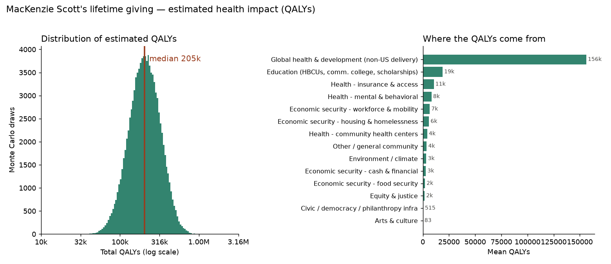
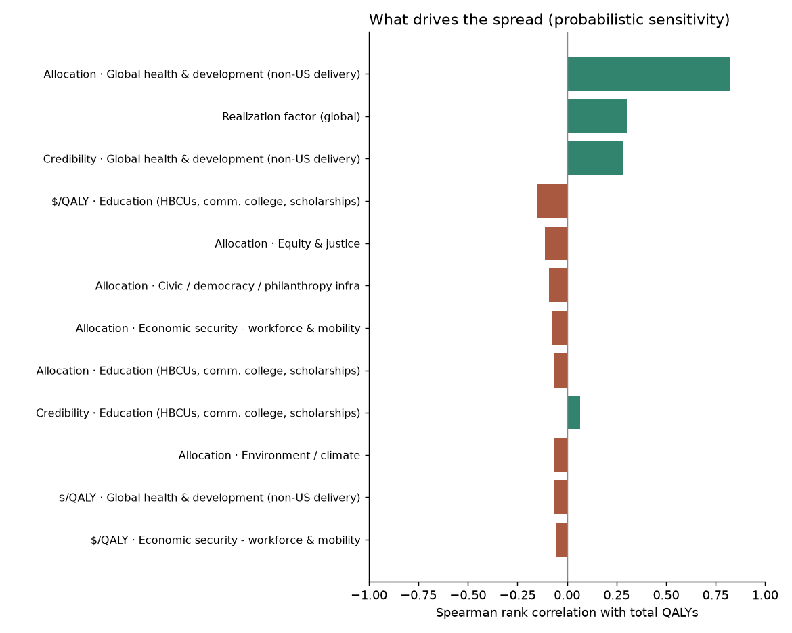

# MacKenzie Scott giving — QALY cost-effectiveness model

**Working paper:** [HTML](https://maxghenis.com/mackenzie-scott-qaly/paper/) · [PDF](https://maxghenis.com/mackenzie-scott-qaly/paper/index.pdf) · [mirror](https://maxghenis.github.io/mackenzie-scott-qaly/) — source in [paper/](paper/), rendered from the committed results and allocation data.

**Reproduce everything** (order matters): `uv sync --all-groups --extra dev`; then `uv run msqaly --write` →
`uv run msqaly-export-params` → `uv run python -m msqaly.exportversions` →
`uv run python -m msqaly.geo` → `uv run python -m msqaly.diagnostics --write` →
`uv run python -m pytest` (sync guards) →
render the paper per [paper/README.md](paper/README.md).

[](https://github.com/MaxGhenis/mackenzie-scott-qaly/actions/workflows/ci.yml)

**▶ Interactive version: [maxghenis.com/mackenzie-scott-qaly](https://maxghenis.com/mackenzie-scott-qaly)** — drag the assumptions and watch the model rerun in your browser (a TypeScript port of this package, reading the same `parameters.yaml`).

A GiveWell-style, fully-parameterized Monte Carlo estimate of the health impact
— in quality-adjusted life-years (QALYs) — of MacKenzie Scott's ~**$26.3 billion**
in lifetime philanthropy ($26.39B nominal 2020–2025, ~$30.3B in 2026 dollars as
modeled; Yield Giving reports over $26 billion in 2,700+ gifts).

It replaces hand-waved "$/QALY by sector" guesses with cost-effectiveness ratios
that are, wherever possible, **derived from published causal estimates** (Medicaid
mortality, community health centers, supportive housing, collaborative-care
depression, education→mortality). Each effect is then **shrunk toward the null in
proportion to how credibly it is causally identified** — a lottery RCT is trusted,
an associational correlation is not — and separately discounted for the gap
between a clean study and a marginal philanthropic dollar.

> **What QALYs do and don't capture.** A QALY is a *health* metric. Most of
> Scott's giving targets economic mobility, education, and equity, whose value is
> largely **non-health** (income, opportunity, rights, wellbeing). This model
> therefore *understates* her total social impact — it answers one specific
> question: how much *health* does the money buy? See "Interpretation" below.

## Quick start

```bash
uv sync --extra dev      # Python 3.14 venv + numpy/pyyaml/matplotlib
uv run msqaly            # 100k Monte Carlo draws — prints summary (no file writes)
uv run msqaly --write    # also regenerate results/ + figures + README block
uv run pytest            # test suite
```

`--write` is what regenerates the committed [`results/`](results/) artifacts
(`summary.md`, `summary.json`, `figure.png`, `sensitivity.png`) and the README
block below; a bare `uv run msqaly` only prints, so casual runs never dirty git.
`uv run python -m msqaly.diagnostics --write` regenerates the
[matching summary](web/matching_diagnostics.json) and
[gift-level ledger](results/gift_ledger.csv). The ledger separates disclosed
and model-imputed amounts in nominal dollars and records recipient identities,
selected pre-gift filings, fallback reasons, and source links.

## Method

The model is a transparent pipeline over `n` Monte Carlo draws (vectorized numpy,
seeded → reproducible). All inputs live in
[`data/parameters.yaml`](data/parameters.yaml); every value carries a `source`,
a typed `unit`, and — for dollar figures — a `dollars_base_year` that
[`validate.py`](src/msqaly/validate.py) checks against the base year on every
load, so a per-DALY figure in a per-QALY slot or an un-inflated old-dollar
figure fails loudly instead of shipping.

1. **Giving, at one price level.** Gifts are recorded as the exact disclosed
   nominal tranches ($26.39B across 2020–2025, each row linked to its
   disclosure — e.g. [Yield Giving's updates](https://yieldgiving.com/essays)
   and [CNBC's year-end accounting](https://www.cnbc.com/2025/12/13/mackenzie-scott-revealed-her-total-charitable-donations-for-2025.html))
   and each tranche is [CPI-inflated](https://fred.stlouisfed.org/series/CPIAUCNS)
   to the 2026 base year (→ ~$30.3B), so the dollars and the cost-per-QALY
   inputs share one price level. Dividing nominal gifts by 2026-dollar costs
   would understate QALYs by ~13%.

2. **QALYs per death averted.** A discounted (3%/yr), quality-weighted annuity
   over remaining life expectancy with a half-cycle correction, calibrated to
   the low-income, middle-aged/older adults who dominate the causal mortality
   studies (~26 remaining years per Chetty et al. 2016's income–life-expectancy
   gradient; utility ~0.78 per US EQ-5D norms) → ~11–14 QALYs per premature
   death averted.

3. **Dollar allocation.** The split across 14 intervention archetypes is a
   **Dirichlet** whose centers are **derived from Scott's own gift-level
   data**: the [Yield Giving database](https://yieldgiving.com/gifts)
   (snapshot in [`data/yieldgiving/`](data/yieldgiving/)) discloses dollar
   amounts for 2,035 of 2,711 gifts — $17.46B nominal, about two-thirds of the
   total — with org-reported focus areas on every disclosed dollar.
   [`allocation.py`](src/msqaly/allocation.py) splits each gift equally across
   its organization's substantive focus areas. The [crosswalk](data/yieldgiving/leaf_to_archetype.yaml)
   assigns dollars to 13 U.S.-anchored categories. Service geography determines
   the share of eligible activities assigned to the fourteenth, global health
   and development. A sync test checks the derived allocation against `parameters.yaml`.
   Undisclosed gifts are imputed, not dropped: her essays give each year's
   *total*, so the undisclosed residual per year window is a known dollar
   amount, distributed across that window's undisclosed gifts in proportion
   to the recipient's **pre-gift IRS 990 revenue**
   ([ProPublica Nonprofit Explorer](https://projects.propublica.org/nonprofits/))
   raised to an elasticity fit on disclosed gifts with a matched pre-gift
   filing. The [paper](paper/index.qmd) reports the fit and sample coverage.
   The pipeline applies a [source-linked correction overlay](data/yieldgiving/match_audit.jsonl)
   to the name-to-EIN matches. For the size estimates, it uses the operating
   chapter for Junior Achievement of the Michigan Great Lakes, the parent
   nonprofit for Mercy Housing, and the charitable foundation for Invest
   Detroit. The legal payee of Scott's gift remains unverified in each case.
   A concentration parameter controls how closely the allocation draws follow
   the estimated shares.

   The [matching summary](web/matching_diagnostics.json) reports coverage by
   gift count and imputed dollars; the [ledger](results/gift_ledger.csv) shows
   which filing or window-median fallback supplies each imputation weight.

4. **Cost-per-QALY per archetype.** Three derivation methods:
   - `cost_per_life` — a published cost-per-life-saved ÷ QALYs-per-death. Used
     for **health insurance/access**: Sommers (2017, *AJHE*) $327k–$867k per
     life saved in 2007 dollars, CPI-inflated to $529k–$1.40M.
   - `cost_per_life_year` — a published cost-per-life-year ÷ the utility-weight
     draw (life-years → QALYs, explicitly). Used for **community health
     centers**: Bailey & Goodman-Bacon (2015) ~$54k/life-year in 2012 dollars,
     CPI-inflated to ~$79k.
   - `cost_per_qaly` — drawn from the cost-effectiveness literature with every
     anchor inflated to 2026 dollars (collaborative-care depression, supportive
     housing), or, for indirect buckets, a deliberately wide prior: *anchored
     to* a causal study where one exists (education→mortality; climate
     mortality-cost-of-carbon) and an explicit *skeptical prior* (AI-proposed,
     author-reviewed) where none does (equity & justice, civic, arts). Each `cost_per_qaly` is the
     cost-effectiveness **conditional on the effect being real and delivered**
     — causal doubt lives in the credibility axis, delivery doubt in
     realization, so no layer double-counts.

5. **Causal credibility (the evidence-quality axis).** Each archetype is rated
   by the identification design of its evidence — `randomized` (RCT/lottery),
   `strong_quasi`, `moderate_quasi`, `observational`, `projection`, or
   `assumption` — and a credibility weight is drawn from that tier's Beta
   distribution (means 0.85 → 0.07; weaker designs are also wider). It linearly
   shrinks QALYs/dollar toward the null of *no health effect*. Credibility is
   **internal validity only**; transport to Scott's grantees belongs to
   realization. The tier levels are AI-proposed, author-reviewed priors — Claude drafted
   them, and the ordering is the defensible part — and the interactive's evidence-stance slider treats
   them as the best-guess midpoint of a two-sided range — from RCT-only
   (non-randomized tiers shrunk to near zero) to face value.

6. **Realization factor.** One global multiplier (triangular, mode 0.80, range
   0.55–1.10; AI-proposed, author-reviewed) for everything between a real effect and her
   marginal grant — external validity/transport, overhead, funging — net of
   the capacity benefits of large unrestricted gifts (CEP 2023).

7. **QALYs** = dollars × share × realization × credibility ÷ cost-per-QALY,
   summed across archetypes.

8. **Monetize & benchmark.** QALYs × HHS's published **value per QALY**
   ([VQALY, Table 3 of the 2026 Data Point](https://aspe.hhs.gov/sites/default/files/documents/2d83af5823915d81871334ee08ad03d9/Standard-RIA-Values-2026.pdf):
   $339k/$726k/$1,105k at 3% in constant 2025 dollars, CPI-inflated to
   $353k/$756k/$1,150k) gives the benefit/cost ratio — the correct series for
   QALY monetization, replacing the earlier VSLY-applied-to-QALYs convention;
   both the VQALY and the frontier are denominated at the 3% reference rate
   and rescaled (adult PV-QALY ratio and child-QALE ratio respectively) when
   the model runs at another rate. The global-health frontier is a
   QALY-equivalent cost derived from
   [GiveWell's 2022–2024 program averages](https://www.givewell.org/impact-estimates).
   Its malaria programs cost $4,000–$5,500 per life saved. After inflating to
   2026 dollars and dividing by about 25.1 discounted QALYs per child death
   averted, the model uses a loguniform range of $150–$260 per QALY.
   Each draw uses the same realization factor for the benchmark and Scott’s
   portfolio. The benchmark draws its own credibility weight from the
   randomized-study tier.

## Results

See [`results/summary.md`](results/summary.md) (regenerated by `uv run msqaly
--write`). Headline figures are reproduced there rather than hard-coded here, so
the README never drifts from the model. As of the committed run:

<!-- RESULTS:START -->
**Median ≈ 205k QALYs** (mean 225k; 90% interval 95k–423k), a blended **$148k/QALY**. Monetized at HHS's value per QALY that is **$150.9B** of health value — a **5.0× benefit/cost ratio**. I use [GiveWell’s 2022–2024 malaria-program averages](https://www.givewell.org/impact-estimates) to set a benchmark with a central cost of $197 per QALY-equivalent. I apply the same realization factor to both portfolios and draw a separate credibility weight for the benchmark from the randomized-study tier. If those costs held across the full $30.3B, the model would yield a median of 105.60M QALYs. The median ratio of benchmark to portfolio QALYs per dollar is **514×**.



The chart ranks inputs by the strength of their Spearman rank correlation with total estimated QALYs.



_Full table: [results/summary.md](results/summary.md). Regenerate with `uv run msqaly --write`._
<!-- RESULTS:END -->

## Interpretation

- **The estimate is dominated by the cost-per-QALY *and credibility* assumptions,
  not the dollar total.** Grounding the ratios in causal estimates and then
  weighting by identification quality (rather than a flat US cost-effectiveness
  threshold) is the whole point of this repo.
- **The evidence weights change the estimated health impact.** The
  [paper's evidence-stance sweep](paper/index.qmd#evidence-philosophy-dominates-everything-else)
  compares near-RCT-only credit with near face value. Stronger evidence
  preserves more of an effect; assumption-based health pathways retain less.
  The largest dollar allocations fund education, equity and justice, and
  workforce development, whose intended benefits extend beyond health.
- **The malaria comparison uses historical costs.** The benchmark uses
  the average costs of malaria programs GiveWell funded from 2022 through
  2024. The portfolio estimate includes gifts across all 14 categories.
- **QALYs ≠ total value.** A WELLBY (wellbeing-year) or consumption-value frame
  would credit the economic-security and education giving far more. This model is
  deliberately scoped to health.

## Limitations

- Allocation centers combine disclosed dollars with a revenue-scaled
  imputation of the undisclosed third. Gifts without a usable pre-gift 990
  receive their window's median weight; the [paper](paper/index.qmd) reports
  the count and the difference from disclosed-only allocation. The pipeline
  splits each gift equally across its organization's focus areas (org-level
  tags, rather than gift-level tags), and the area-to-archetype mapping
  embeds judgment ([`leaf_to_archetype.yaml`](data/yieldgiving/leaf_to_archetype.yaml)).
  Neither the fit nor the matching review establishes that recipients with
  undisclosed amounts resemble those with disclosed amounts.
- Several archetypes (equity & justice, civic, arts) have no clean health pathway;
  their wide distributions reflect genuine ignorance, not measured effect.
- Causal estimates are transported across populations and time; the realization
  factor is a coarse correction.
- **Correlation structure is stylized.** Credibility is drawn independently per
  archetype while realization is one global draw — two opposite extremes. A
  tier-correlated credibility variant widens the 90% interval by ~7% and leaves
  the median unchanged. Credibility is also strictly positive: the model puts no
  probability on zero or harmful effects (assumption-tier means of 0.07
  approximate, but never reach, a null).
- **The evidence-tier levels, realization triangle, and Dirichlet concentration
  are AI-proposed, author-reviewed priors** — Claude drafted them, and no
  literature estimates exist; they are labeled as
  such in the parameter file, and the sensitivity tornado + interactive sliders
  are the stress test.
- Monetization uses HHS's published value per QALY; it affects only the
  benefit/cost ratio, never the QALY count.
- **Funding capacity.** The model holds the malaria benchmark's cost per
  QALY fixed as spending increases. The return on another donation depends
  on which programs still need funding. GiveWell directed
  [$397 million across all programs from February 2024 through January 2025](https://blog.givewell.org/2025/08/13/givewells-2024-metrics-and-impact/).
  Its [separate evaluation of GiveDirectly](https://blog.givewell.org/2024/11/12/re-evaluating-the-impact-of-unconditional-cash-transfers/)
  counts gains in household consumption as well as health.
- Effects are modeled as static cost-per-QALY ratios, not a dynamic life-table
  microsimulation.

## Layout

```
data/parameters.yaml     all inputs, each with a citation
data/yieldgiving/        gift-database snapshot + area->archetype mapping
src/msqaly/
  distributions.py       spec -> Monte Carlo samples
  model.py               causal chains + propagation
  allocation.py          Yield Giving data -> allocation_share centers
  cli.py                 run, summarize, plot
tests/                   integrity, distribution, allocation-sync, end-to-end
SOURCES.md               annotated bibliography
results/                 generated outputs (committed)
```

## Sources

Full annotated bibliography in [`SOURCES.md`](SOURCES.md). Not affiliated with,
or endorsed by, MacKenzie Scott, Yield Giving, or GiveWell.
