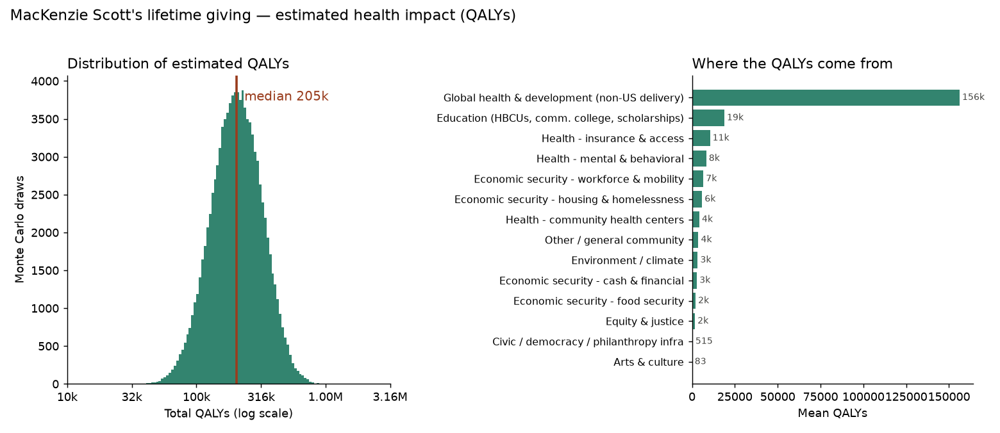
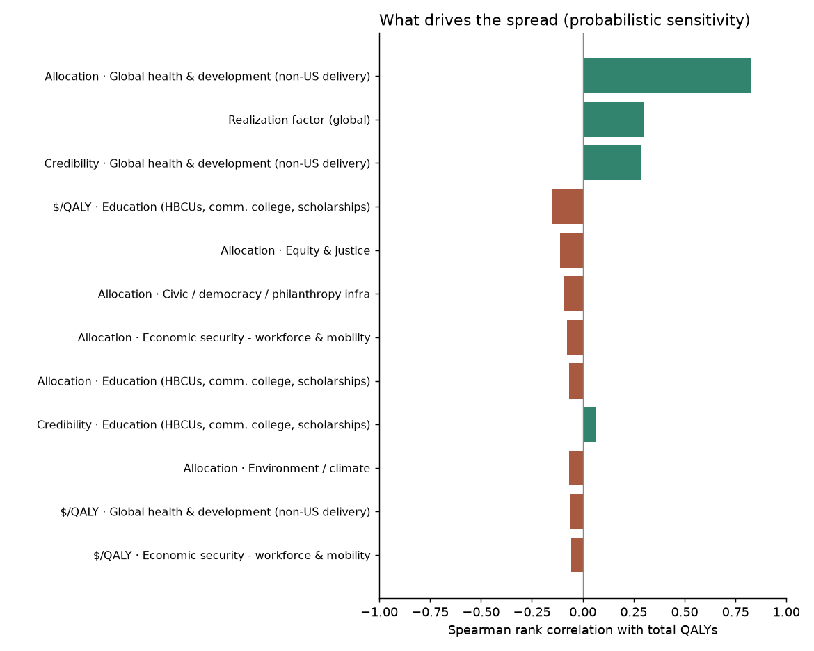

```{python}
#| echo: false
import json
import sys
from pathlib import Path

import numpy as np
import pandas as pd
import yaml

ROOT = Path.cwd().resolve()
if not (ROOT / "results").exists():
    ROOT = ROOT.parent
sys.path.insert(0, str(ROOT / "src"))

S = json.loads((ROOT / "results" / "summary.json").read_text())
MATCHING = json.loads((ROOT / "web" / "matching_diagnostics.json").read_text())
GEO = json.loads((ROOT / "web" / "geo.json").read_text())
V10 = json.loads((ROOT / "web" / "allocation_v10.json").read_text())
V11 = json.loads((ROOT / "web" / "allocation_v11.json").read_text())
P = yaml.safe_load((ROOT / "data" / "parameters.yaml").read_text())

from msqaly.allocation import derive_shares
_, DIAG = derive_shares()
_, DIAG_DISCLOSED = derive_shares(impute=False)
_max_share_shift = max(
    abs(DIAG["raw_shares"][key] - DIAG_DISCLOSED["raw_shares"][key])
    for key in DIAG["raw_shares"]
)

tq = S["total_qalys"]
def k(x): return f"{x/1000:,.0f},000" if x >= 10000 else f"{x:,.0f}"
def kk(x): return f"{round(x/1000):,}k"
def usd(x):
    if abs(x) >= 0.9995e9: return f"${x/1e9:,.2f}B"
    if abs(x) >= 0.9995e6: return f"${x/1e6:,.0f}M"
    return f"${x:,.0f}"

F = dict(
    median=f"{tq['median']:,.0f}",
    median_k=k(tq['median']),
    mean=f"{tq['mean']:,.0f}",
    p05=k(tq['p05']), p95=k(tq['p95']),
    blended=f"${S['blended_cost_per_qaly_median']:,.0f}",
    giving=f"${S['total_giving_usd']/1e9:,.1f}B",
    frontier_mult=f"{S['frontier_multiple_median']:,.0f}",
    frontier_q=f"{S['frontier_qalys_median']/1e6:,.1f} million",
    elasticity=f"{DIAG['elasticity']:.2f}",
    r2=f"{DIAG['elasticity_r2']:.2f}",
    n_cal=f"{DIAG['n_calibration']:,}",
    n_orgs=f"{DIAG['n_orgs']:,}",
    n_gifts=f"{DIAG['n_gifts']:,}",
    n_disclosed=f"{DIAG['n_disclosed']:,}",
    n_undisclosed=f"{DIAG['n_undisclosed']:,}",
    n_fallback=f"{DIAG['n_revenue_fallback']:,}",
    fallback_gift_pct=f"{100 * MATCHING['gifts']['fallback_share_of_undisclosed_gifts']:.1f}%",
    fallback_dollar_pct=f"{100 * MATCHING['nominal_usd']['fallback_share_of_imputed']:.1f}%",
    fallback_dollars=f"${MATCHING['nominal_usd']['fallback_imputed'] / 1e9:.2f} billion",
    tenfold=f"{10 ** DIAG['elasticity']:.1f}",
    max_share_shift_pp=f"{100 * _max_share_shift:.1f}",
    disclosed_b=f"${DIAG['disclosed_usd']/1e9:,.2f}B",
    imputed_b=f"${DIAG['imputed_usd']/1e9:,.2f}B",
    abroad_share=f"{100*DIAG['raw_shares']['global_health']:.2f}%",
    abroad_share_1=f"{100*DIAG['raw_shares']['global_health']:.1f}%",
)

per = S["per_archetype_mean"]
mean_total = sum(per.values())
gh_label = [kb for kb in per if "Global health" in kb][0]
F["gh_share"] = f"{100*per[gh_label]/mean_total:.1f}%"
F["gh_mean"] = f"{per[gh_label]:,.0f}"
F["bc"] = f"{S['bc_ratio']['median']:.1f}"
F["bc_p05"] = f"{S['bc_ratio']['p05']:.1f}"
F["bc_p95"] = f"{S['bc_ratio']['p95']:.1f}"

# Disclosed dollars to organizations reporting non-US service locations,
# under the audited us_share overlay (and under the raw rule, for contrast).
from msqaly.allocation import load_geo_overlay, nonus_fraction
_overlay = load_geo_overlay()
_orgs_raw = json.loads((ROOT / "data" / "yieldgiving" / "organisations.json").read_text())
_ab_audit = _ab_raw = _disc = 0.0
for _o in _orgs_raw:
    _usd = sum(g.get("amount") or 0 for g in _o.get("gifts", []))
    if not _usd or not _o.get("locations"):
        continue
    _disc += _usd
    _raw = nonus_fraction(_o.get("locations"))
    _ab_raw += _usd * _raw
    _ab_audit += _usd * _overlay.get(_o["name"], _raw)
F["abroad_disc_audited_b"] = f"${_ab_audit/1e9:,.2f}B"
F["abroad_disc_audited_pct"] = f"{100*_ab_audit/_disc:.0f}%"
F["abroad_disc_raw_pct"] = f"{100*_ab_raw/_disc:.1f}%"

# Region mix of the routed global-health bucket (from the archetype matrix).
_ghm = GEO["archetype_region_matrix"]["matrix"]["global_health"]
F["gh_ssa"] = f"{100*_ghm.get('sub-_saharan_africa', 0):.0f}%"
F["gh_sasia"] = f"{100*_ghm.get('south_asia', 0):.0f}%"
F["gh_latam"] = f"{100*_ghm.get('latin_america&_caribbean', 0):.0f}%"
F["gh_unattrib"] = f"{100*_ghm.get('global', 0):.0f}%"
F["gh_hic"] = f"{100*(_ghm.get('europe&_central_asia', 0) + _ghm.get('canada', 0)):.0f}%"
```

# Introduction

MacKenzie Scott gave away $7.17 billion in 2025 [@cnbc2025scott]; Giving USA counts $6.65 billion of it against $19.2 billion in U.S. megagift dollars — about a third of that year's megagift value [@givingusa2026; @ap2026givingusa]. (The bases differ: Yield Giving's own annual total is the larger figure.) Her disclosed lifetime total is $26.39 billion across `{python} F["n_gifts"]` gifts to `{python} F["n_orgs"]` organizations since 2019 [@yieldgiving2026]. Almost none of it is denominated in health, and, to my knowledge, no published estimate prices the portfolio in outcomes of any kind.

This paper does so in the unit health economists use to compare a death averted against years lived in better health: the quality-adjusted life-year. The exercise is deliberately in the style of a charity evaluator's cost-effectiveness analysis [@givewell2026impact], scaled from a program to a portfolio, with one addition the setting forces: because most of the portfolio funds interventions whose health effects have never been causally measured, the model makes its epistemics explicit. Every effect is shrunk toward zero in proportion to how well its supporting study identifies causation, the shrinkage schedule is a slider rather than a buried constant, and I report estimates across a range of evidence weights, from near-exclusive credit for randomized evidence to taking effects at near face value.

The paper makes four contributions. It provides what I believe is the first outside, portfolio-level cost-effectiveness estimate of Scott's giving, and I have found no comparable outside estimate for any other individual mega-donor — funder-run portfolio metrics exist, including GiveWell's aggregate impact estimates [@givewell2026impact], Robin Hood's benefit–cost framework [@robinhood2025], the Constellation Fund's portfolio reporting [@constellation2025], and social-rate-of-return analysis of USAID's Development Innovation Ventures portfolio [@cega2023div]; the difference here is independence from the donor, a subject who publishes no outcome data, and explicit evidence weighting: a best-guess median of `{python} F["median_k"]` QALYs from $26.39 billion nominal (`{python} F["giving"]` in 2026 dollars), a blended `{python} F["blended"]` per QALY, and a median benefit–cost ratio of `{python} F["bc"]` under the HHS regulatory value-per-QALY distribution [@aspe2026values]. It estimates extreme geographic concentration of impact under its pricing assumptions: the `{python} F["abroad_share_1"]` of dollars funding global health and development delivered outside the United States accounts for `{python} F["gh_share"]` of estimated health impact. It reports a new empirical regularity in the gift data itself: across `{python} F["n_cal"]` disclosed gift–filing pairs, gift size scales with recipient pre-gift revenue to the power `{python} F["elasticity"]` (R² `{python} F["r2"]`) — Scott's giving is far flatter across organization size than proportional. And it demonstrates a working method for auditable, AI-assisted cost-effectiveness modeling: the model was built with a frontier language model, reviewed and corrected in public through the revision history summarized in the robustness section, audited by two independent model families against primary filings, and ships with versioned parameters, machine-checked citations, and a browser implementation that reruns the full Monte Carlo under any reader's assumptions.

The unit of account deserves a caveat before any number. QALYs measure health. Most of Scott's portfolio aims at other things — education, economic mobility, equity, civic infrastructure — whose primary benefits are not health benefits. A finding that a dollar of education philanthropy produces few QALYs is a statement about the lens, not a verdict on the gift. The estimates are a partial, health-only accounting under positive-effect priors — not a lower bound on total wellbeing: the lens omits the primary intended benefits of most of the portfolio, and the model places no probability on zero or harmful effects, a structural choice the limitations section returns to.

# Data

## The ledger

Scott's essays disclose giving in dated tranches totaling $26.39 billion nominal over 2020–2025. The model inflates each tranche — booked by disclosure year — to 2026 dollars (CPI-U, anchored to May 2026), so dollars and cost-effectiveness evidence share one price level: `{python} F["giving"]` total. All derivations below, and the replication repository, start from a verbatim snapshot of the Yield Giving gift database retrieved July 11, 2026 [@yieldgiving2026].

## Allocation across causes

Scott publishes no aggregate dollars-by-cause breakdown, but she publishes something more granular: a gift-level database listing every recipient organization, its self-reported focus areas, and — for `{python} F["n_disclosed"]` of `{python} F["n_gifts"]` gifts (`{python} F["disclosed_b"]`, about two-thirds of the nominal total) — the dollar amount. I split each organization’s dollars across its substantive focus areas using a crosswalk for Yield Giving’s 53 area labels. The crosswalk assigns dollars to 13 U.S.-anchored categories. For eligible health and development activities, I use service locations to allocate a share to a fourteenth category, global health and development.

I distribute each period's undisclosed residual across its undisclosed gifts in proportion to recipients' pre-gift IRS Form 990 total revenue [@propublica2026], raised to an elasticity fit on the disclosed pairs. Scott's essays supply the period totals. I use the latest filing year strictly before the gift year to avoid including the gift itself in revenue.

Across `{python} F["n_cal"]` disclosed gift–filing pairs, log gift size rises with log revenue with slope `{python} F["elasticity"]` (R² `{python} F["r2"]`). In this matched sample, a 10× larger organization receives about `{python} F["tenfold"]`× as much money. The fit covers `{python} F["n_cal"]` of `{python} F["n_disclosed"]` disclosed gifts and `{python} F["n_gifts"]` total gifts, treats repeated gifts to an organization as independent, and pools years. Of the `{python} F["n_undisclosed"]` undisclosed gifts, `{python} F["n_fallback"]` (`{python} F["fallback_gift_pct"]`) lack a usable filing and receive their period's median weight. Those gifts receive `{python} F["fallback_dollars"]` nominal, or `{python} F["fallback_dollar_pct"]` of imputed dollars. This descriptive fit supplies the imputation weights; it does not establish predictive accuracy for undisclosed gifts.

The model matches recipients to Form 990 filers by name and applies corrections backed by recipient websites and filings. To estimate organization size, it uses the operating chapter for Junior Achievement of the Michigan Great Lakes, the parent nonprofit for Mercy Housing, and the charitable foundation for Invest Detroit. The legal payee of Scott's gift remains unverified in each case. [Form 990 match records](https://github.com/MaxGhenis/mackenzie-scott-qaly/blob/main/data/yieldgiving/match_audit.jsonl).

The gift-level ledger separates disclosed and imputed nominal amounts and records identity and filing sources, selected pre-gift revenue, and fallback reasons. The matching summary reports how many gifts have usable filings and how many imputed dollars use fallback weights. Relative to disclosed-only allocation, imputation moves each cause share by at most `{python} F["max_share_shift_pp"]` percentage points under these assumptions. [Gift-level ledger](https://github.com/MaxGhenis/mackenzie-scott-qaly/blob/main/results/gift_ledger.csv) · [Matching summary](https://github.com/MaxGhenis/mackenzie-scott-qaly/blob/main/web/matching_diagnostics.json).

## Delivery geography

Each organization reports service locations. Weighting disclosed dollars by the audited share of each organization's locations outside the United States, an estimated `{python} F["abroad_disc_audited_pct"]` of disclosed dollars (`{python} F["abroad_disc_audited_b"]` of `{python} F["disclosed_b"]`) sits with organizations reporting non-U.S. service locations — `{python} F["abroad_disc_raw_pct"]` under the raw rule that counts a bare "global" listing as fully non-U.S. — led by environment, health, and funding intermediaries. Locations are an equal-split proxy: a listed location is not an expenditure share, and no organization reports how Scott's own gift was deployed. The model prices geography through a single channel: health-relevant dollars route to a global-health archetype in proportion to the recipient's non-U.S. service share, because global health delivery is the one category with a published cost-per-QALY evidence base an order of magnitude below U.S. anchors. Education and climate dollars keep their U.S.-study anchors wherever they are delivered; if geography changes their effectiveness, the model does not capture it.

The coarsest geographic field is the bare label "global." An audit of the 50 organizations with the most dollars attached to that label — 87% of its dollars; 20 of the 50 also list other locations — replaced the blanket assumption of fully-abroad delivery with fractions coded independently by two model families from each organization's filings and program reports, then reconciled — the second coder confirmed 33 within tolerance and disputed 17; four disputes were adjudicated to documented filings arithmetic, and final fractions average the two coders everywhere else, with per-organization sources and confidence grades — 16 high, 17 medium, 17 low — committed to the repository. Many "global" organizations operate substantially in the United States: Planned Parenthood and Crisis Text Line, for example, list "global" service but are roughly 95% and 93% U.S. in their most recent organization-wide reporting — later-period proxies for how earlier gifts were deployed, since neither reports gift-level allocation. The audited allocation routes `{python} F["abroad_share"]` of the ledger to the global health and development archetype. That routed bucket is itself mixed: its dollars sit `{python} F["gh_ssa"]` in Sub-Saharan Africa, `{python} F["gh_sasia"]` in South Asia, and `{python} F["gh_latam"]` in Latin America, but `{python} F["gh_unattrib"]` is unattributable multi-region activity and roughly `{python} F["gh_hic"]` sits in Europe & Central Asia plus Canada — regions that are not classified by income here, so the bucket's true high-income share is unidentified — all priced at the same low-and-middle-income anchors, a coarseness the limitations section flags.

# Model

Each Monte Carlo draw allocates the giving across archetypes (a Dirichlet centered on the derived shares), assigns each archetype a cost per QALY drawn from a distribution anchored in published estimates, and multiplies the implied QALYs by two independent discounts. **Causal credibility** asks whether the measured effect is real. Each archetype carries the identification tier of its best supporting evidence, and the tier sets a Beta-distributed shrinkage factor toward the null: a lottery-randomized wealth shock [@cesarini2016wealth] or the Medicaid mortality quasi-experiments — the ACA expansions [@miller2021medicaid], with cost–benefit arithmetic from the pre-ACA state expansions [@sommers2017medicaid] whose spending component draws on the Oregon Health Insurance Experiment [@finkelstein2012oregon] — keeps most of its effect; a child-targeted cash quasi-experiment [@aizer2016cash], with related designs catalogued in the parameter file, anchors the cash bucket; the community-health-center rollout design [@bailey2015war] and similar contested quasi-experiments keep less; associational and assumption-only categories are shrunk near zero. **Realization** asks whether a marginal philanthropic dollar delivers the studied effect at all — transport to different populations, overhead, and funging, net of possible capacity effects: surveyed Scott recipients report stronger capacity and reach [@cep2023gifts], self-reports on whose basis the model permits realization above one (an author judgment, not a CEP effect estimate). It is one global triangular draw with mode 0.80 on support 0.55–1.10.

The two multipliers are designed to partition the doubt — transportability concerns in realization, identification concerns in credibility, cost-per-QALY priors stated conditional on the effect being real and delivered — though the separation is imperfect at the prior boundaries: several anchors already average over mixed null-and-positive evidence before the credibility discount applies (a limitation noted below). Allocation uncertainty is a Dirichlet with concentration 60 around the derived centers — a judgment prior, implying for example a roughly 1.3–10% ninety-percent range on the global-health share — and represents subjective allocation uncertainty rather than sampling uncertainty propagated from the gift data pipeline. The tier ordering is the defensible part; the levels are judgment, proposed by a language model and reviewed by the author, and the results section reports the full consequence of disagreeing with them.

Health effects arrive in different natural units — lives saved, life-years, depression-free days — and are converted to discounted QALYs at a 3% annual rate under source-specific conventions: adult mortality anchors sample roughly 26 remaining life-years at a utility draw centered near 0.78, the frontier's child-mortality benchmark uses a fixed ~65 remaining years at utility 0.87, and direct cost-per-QALY anchors keep their sources' conventions. Every parameter's unit and dollar vintage is machine-validated at load. The global-health frontier benchmark is handicapped within the same framework: GiveWell's 2022–2024 average costs per life saved for bed nets and seasonal malaria chemoprevention [@givewell2026impact], converted to roughly $175–$241 per discounted QALY-equivalent under this model's own conventions (a model conversion, not a GiveWell QALY figure), modeled as loguniform $150–$260, sharing each draw's realization multiplier, and receiving RCT-grade credibility — the strongest tier — where portfolio archetypes receive their own.

# Results

```{python}
#| echo: false
tiers = {a: P["archetypes"][a].get("causal_credibility", "—") for a in P["archetypes"]}
labels = {a: P["archetypes"][a]["label"] for a in P["archetypes"]}
label_to_key = {v: k for k, v in labels.items()}
giving_usd = S["total_giving_usd"]
rows = []
for lab, q in sorted(per.items(), key=lambda kv: -kv[1]):
    key = label_to_key[lab]
    share = V11["allocation_share"][key]
    d = share * giving_usd
    rows.append({
        "Cause": lab,
        "Dollars": usd(d),
        "% of $": f"{100*share:.0f}%",
        "QALYs": f"{q:,.0f}",
        "% of QALYs": f"{100*q/mean_total:.0f}%" if q/mean_total >= 0.005 else "<1%",
        "$/QALY": usd(d/q) if q > 0 else "—",
        "Evidence": tiers[key],
    })
rows.append({"Cause": "Total", "Dollars": usd(giving_usd), "% of $": "100%",
             "QALYs": f"{mean_total:,.0f}", "% of QALYs": "100%",
             "$/QALY": usd(giving_usd/mean_total), "Evidence": ""})
cause_df = pd.DataFrame(rows)
ev_tiers = {"randomized", "strong_quasi", "moderate_quasi", "quasi_contested"}
ev_ratios = []
for lab, q in per.items():
    key = label_to_key[lab]
    if key == "global_health" or q <= 0:
        continue
    if any(t in str(tiers[key]) for t in ("randomized", "quasi")):
        ev_ratios.append(V11["allocation_share"][key] * giving_usd / q)
F2 = dict(
    gh_cpq=usd(V11["allocation_share"]["global_health"] * giving_usd / per[gh_label]),
    ev_lo=usd(min(ev_ratios)), ev_hi=usd(max(ev_ratios)),
    spread=f"{max(V11['allocation_share'][label_to_key[l]]*giving_usd/q for l, q in per.items() if q > 0) / min(V11['allocation_share'][label_to_key[l]]*giving_usd/q for l, q in per.items() if q > 0):,.0f}",
)
```

At the best-guess defaults (100,000 draws), the portfolio produces a median of `{python} F["median"]` QALYs, with a 90% interval of `{python} F["p05"]` to `{python} F["p95"]` and a mean of `{python} F["mean"]`. The interval is a probabilistic-sensitivity range under the stated priors, not a confidence interval; Monte Carlo error on the median is a few hundred QALYs. The blended cost-effectiveness — dollars given over QALYs produced, at the median — is `{python} F["blended"]` per QALY. Monetized under the value-per-QALY distribution HHS recommends for regulatory analysis (central $726,000 at 3%; @aspe2026values, Table 3), the median draw-level benefit–cost ratio is `{python} F["bc"]` (90% interval `{python} F["bc_p05"]`–`{python} F["bc_p95"]`, reflecting both health-output and valuation uncertainty). @fig-dist shows the full distribution.

{#fig-dist}

## Where it comes from

@tbl-cause decomposes the mean estimate by cause. The result is the paper's central contrast: the global health and development slice — `{python} F["abroad_share_1"]` of dollars — contributes `{python} F["gh_share"]` of estimated QALYs, at a modeled cost of about `{python} F2["gh_cpq"]` per QALY against `{python} F2["ev_lo"]`–`{python} F2["ev_hi"]` for the causes with quasi-experimental or better U.S. evidence. The `{python} F2["spread"]`-fold spread in modeled cost-effectiveness within a single donor's portfolio, under stipulated priors, is partly the lens speaking — its low end is dominated by assumption-tier buckets whose near-zero credibility is an input, and whose main benefits QALYs do not count — but the spread among evidenced health buckets alone exceeds an order of magnitude, restating in one column an empirical regularity long emphasized in the effective-altruism literature [@ord2013]: the cheapest health in the world is not bought where most philanthropic dollars are spent.

```{python}
#| label: tbl-cause
#| tbl-cap: "Dollars and estimated QALYs by cause, best-guess defaults. Dollars apply the allocation centers to the 2026-dollar total; QALYs are mean contributions (only means are additive). $/QALY is the ratio of center dollars to mean QALYs after credibility and realization adjustments — a ratio of expectations, not the raw study anchor."
from IPython.display import Markdown
Markdown(cause_df.to_markdown(index=False))
```

```{python}
#| echo: false
M = GEO["archetype_region_matrix"]["matrix"]
region_meta = {r["key"]: r for r in GEO["archetype_region_matrix"]["regions"]}
acc = {}
for lab, q in per.items():
    key = label_to_key[lab]
    d = V11["allocation_share"][key] * giving_usd
    for region, w in M.get(key, {}).items():
        a = acc.setdefault(region, [0.0, 0.0])
        a[0] += d * w
        a[1] += q * w
geo_rows = []
for region, (d, q) in sorted(acc.items(), key=lambda kv: -kv[1][1]):
    meta = region_meta[region]
    geo_rows.append({
        "Region": meta["label"] + (" *" if meta["unspecified"] else ""),
        "Dollars": usd(d),
        "% of $": f"{100*d/giving_usd:.0f}%" if d/giving_usd >= 0.005 else "<1%",
        "QALYs": f"{q:,.0f}",
        "% of QALYs": f"{100*q/mean_total:.0f}%" if q/mean_total >= 0.005 else "<1%",
        "$/QALY": usd(d/q) if q > 0 else "—",
    })
geo_df = pd.DataFrame(geo_rows)
ssa = [r for r in geo_rows if "Sub-Saharan" in r["Region"]][0]
usnat = [r for r in geo_rows if "national" in r["Region"]][0]
```

@tbl-geo decomposes the same run by delivery geography. The table is a by-construction decomposition, not evidence of regional differences: within each cause the model prices every delivery location identically — the health routing to global anchors is its only geographic pricing — so a cause's QALYs follow its dollars across regions. Under that construction, Sub-Saharan Africa receives `{python} ssa["% of $"]` of dollars and `{python} ssa["% of QALYs"]` of estimated QALYs at `{python} ssa["$/QALY"]` per QALY; nationally-scoped U.S. giving receives `{python} usnat["% of $"]` of dollars and `{python} usnat["% of QALYs"]` of QALYs at `{python} usnat["$/QALY"]`.

```{python}
#| label: tbl-geo
#| tbl-cap: "A deterministic post-estimation decomposition of mean archetype QALYs by delivery geography — no region-level effect or uncertainty is estimated, and geography affects pricing only through the global-health routing. Asterisked rows are reporting granularity (national or multi-region listings), not places. Geography derives from each organization's reported service locations, equal-split, with audited fractions for the 50 largest \"global\"-listed organizations."
Markdown(geo_df.to_markdown(index=False))
```

## Against the global-health frontier

Under the default assumptions, I estimate that a dollar at the malaria-prevention benchmark buys `{python} F["frontier_mult"]` times as many QALYs as an average dollar in Scott’s portfolio. Applying those costs to her entire portfolio yields a hypothetical median of `{python} F["frontier_q"]` QALYs. GiveWell reports average costs for grants it funded in 2022–2024. The return on an additional donation depends on which programs still need funding and what they would spend it on [@givewell2026impact]. The model holds costs fixed as funding increases. GiveWell’s separate assessment of direct cash transfers includes consumption gains alongside health effects [@givewell2024cash].

# Robustness

## Sensitivity to evidence weights {#evidence-philosophy-dominates-everything-else}

```{python}
#| label: fig-stance
#| fig-cap: "Median total QALYs across the evidence-stance range, 100,000 draws per point, seed 0. The stance interpolates each tier's credibility mean piecewise-linearly from a near-RCT-only floor (non-randomized tiers at mean 0.01; randomized tier at its drafted mean) through the drafted best-guess tiers (0.5) to near face value (all means 0.999). A scenario path, not a bound; tier concentrations are held fixed."
import matplotlib.pyplot as plt
from msqaly import load_params, run

def stance_median(s_val, n=100_000):
    p = load_params()
    for name, t in p["evidence_tiers"].items():
        base = t["mean"]
        floor = base if name == "randomized" else 0.01
        m = floor + (s_val/0.5)*(base-floor) if s_val <= 0.5 else base + ((s_val-0.5)/0.5)*(0.999-base)
        t["mean"] = min(max(m, 0.001), 0.999)
    r = run(p, n=n, seed=0)
    return float(np.median(np.asarray(r.total_qalys)))

grid = [0.0, 0.125, 0.25, 0.375, 0.5, 0.625, 0.75, 0.875, 1.0]
meds = [stance_median(s_val) for s_val in grid]

fig, ax = plt.subplots(figsize=(7, 3.6))
ax.plot(grid, meds, marker="o", color="#b45309", lw=2)
ax.axvline(0.5, color="#94a3b8", ls="--", lw=1)
ax.set_yscale("log")
ax.set_xticks([0, 0.5, 1.0])
ax.set_xticklabels(["Near-RCT-only", "Best guess\n(default)", "Near face value"])
ax.set_ylabel("Median QALYs (log scale)")
for s_val, m in [(0.0, meds[0]), (0.5, meds[4]), (1.0, meds[-1])]:
    ax.annotate(f"{m:,.0f}", (s_val, m), textcoords="offset points", xytext=(6, 8), fontsize=9)
ax.spines[["top", "right"]].set_visible(False)
plt.tight_layout()
plt.show()

F_rct = f"{meds[0]:,.0f}"
F_face = f"{meds[-1]:,.0f}"
F_stance_ratio = f"{meds[-1] / meds[0]:.0f}"
```

At the near-RCT-only floor — non-randomized tiers shrunk to a credibility mean of 0.01, the randomized tier kept at its drafted mean — the median collapses to `{python} F_rct` QALYs, dominated by the randomized-tier mental-health bucket; at near face value (all tier means 0.999) it rises to `{python} F_face` (@fig-stance). The endpoint medians differ by a factor of `{python} F_stance_ratio`. The earlier model used U.S. costs for all health spending and yielded a median of roughly 70,000 QALYs (§5.3). The Spearman tornado (@fig-tornado) tells the same story within the default stance: the top three drivers are the global-health allocation share, the realization factor, and global-health credibility.

{#fig-tornado}

## Allocation corrections

The July 2026 geography audit moved the routed global-health share from 4.93% to 4.82%, the median from 203,949 to 201,923 QALYs, and the blended figure from $148,577 to $150,067 per QALY. The repository preserves these historical allocations as v1.0 and v1.1. [July 20 results](https://github.com/MaxGhenis/mackenzie-scott-qaly/blob/v2026.07.20/results/summary.json) · [July 22 results](https://github.com/MaxGhenis/mackenzie-scott-qaly/blob/v2026.07.22/results/summary.json).

The November 16, 2026 Form 990 corrections produce the current v1.2 allocation: `{python} F["abroad_share"]` for global health, a median of `{python} F["median"]` QALYs, and `{python} F["blended"]` per QALY. The browser version offers all three allocations for comparison.

## Corrections history

The repository records the following changes in the median estimate.

| Change | Median before → after | Caught by |
|---|---|---|
| Cross-model review: dollar vintages normalized, a life-year→QALY conversion made explicit, frontier benchmark re-derived, one citation re-attributed | ~98,000 → ~87,000 | second model family |
| Allocation replaced with the derivation from Scott's own gift database | ~87,000 → ~70,000 | author + model |
| Price internationally delivered health dollars at global-health anchors (v1.0) | ~70,000 → ~204,000 | a reader |
| Revise the service shares of organizations listing "global" (v1.1) | ~204,000 → ~202,000 | model audit |
| Correct 21 Form 990 identities and revise the revenue inputs for three related entities (v1.2, November 16, 2026) | ~202,000 → `{python} F["median_k"]` | source-linked identity review |

# Construction and auditability

The model was built with a frontier language model (Anthropic's Claude), with the author reviewing every parameter and assumption; adversarial review by a second model family (OpenAI's), plus reader corrections, produced the revision history above. Three mechanisms make the result checkable rather than merely stated. Parameters live in one typed file in which every value carries its unit, dollar vintage, and inline citation, machine-validated at load; an annotated bibliography maps each quantitative input to its primary source and price-level conversion. Sync tests force the published web parameters, allocation shares, and geography exports to equal fresh derivations from the committed data snapshots, and the body of this manuscript interpolates its model-derived numbers from those same artifacts at render time (the abstract's figures are typed copies of the interpolated values; externally sourced constants carry citations). And the audit trail is data: the 990 match audit ships as its applied per-row overlay, and the 50-organization geography audit ships with per-organization sources and confidence grades — both applied by the pipeline rather than folded silently into parameters.

The browser implementation is a checked TypeScript port that reruns the full Monte Carlo client-side; every figure in this paper can be reproduced, and every assumption overridden, at [maxghenis.com/mackenzie-scott-qaly](https://maxghenis.com/mackenzie-scott-qaly). The repository, including this manuscript's source, is at [github.com/MaxGhenis/mackenzie-scott-qaly](https://github.com/MaxGhenis/mackenzie-scott-qaly).

# Limitations

I chose the credibility weights and realization distribution by judgment. The stance scenarios vary the mean credibility weights while holding their concentrations and the realization distribution fixed. The QALY lens counts only health, so the estimate is a partial accounting that omits both the non-health benefits where Scott concentrates — education, mobility, equity — and any possible harms; it is not a floor on total wellbeing. Credibility shrinks toward zero but never below it, so the model places no mass on harmful giving; the closest available zero scenario is the near-RCT-only stance floor, which drives unsupported archetypes to ~1% credit. Allocation splits each organization's dollars equally across its focus areas and service locations; both are coarse, and the geography audit covers only the 50 largest "global"-listed organizations. Realization is one global draw, so it cannot vary by cause. Archetype anchors treat heterogeneous organizations as draws from one distribution. Within each cause, delivery regions are priced identically, so the geographic decomposition exposes assumptions rather than measuring regional differences. The undisclosed third of dollars is imputed from a fitted elasticity, not observed. The routed global-health bucket prices its unattributable and Europe-&-Central-Asia-plus-Canada dollars — roughly a fifth of the bucket, whose true income mix is unidentified — at low-and-middle-income anchors, an upward-bias channel. Several cost priors average over mixed null-and-positive evidence before the credibility discount applies, so the two-multiplier separation of doubts is imperfect at those boundaries. The Dirichlet allocation spread is a subjective prior; uncertainty from the elasticity fit, unmatched filings, the focus-area crosswalk, and the geography audit is not propagated. Allocation shares are derived in nominal dollars and applied to the real total; re-deriving in real dollars moves shares by hundredths of a percentage point. The geography audit's scalar U.S. shares and regional decompositions were reconciled separately and can differ by fractions of a point per organization. Finally, several anchors rest on a small number of quasi-experimental papers whose external validity to Scott's grantees is exactly what the realization factor is guessing at.

# Conclusion

Measured in health, MacKenzie Scott's $26 billion buys an estimated median of about `{python} F["median_k"]` quality-adjusted life-years — several times its cost under the government's own regulatory valuation — and most of that estimated health comes from the twentieth of her dollars funding health and development delivered abroad. The number is a model output under stated priors, not a fact, and the model's most important output is not the point estimate but the machinery around it: explicit evidence weights, a `{python} F_stance_ratio`-fold stance range that any reader can traverse, versioned corrections, and audits committed as data. Portfolio-scale philanthropy is measurable in outcomes without waiting for donors to publish outcome data — their own gift lists, recipients' tax filings, and the published causal literature suffice — and the same machinery applies to any large giver whose public disclosures carry comparable gift-level allocation and geography fields. The invitation of the interactive version is the paper's real conclusion: disagree with a parameter, move it, and watch what survives.

# Acknowledgments {.unnumbered}

I thank readers on LinkedIn and the EA Forum whose corrections materially improved the model, including the reader who identified the original mispricing of internationally delivered health dollars. The model, audits, and this manuscript were built with Anthropic's Claude, with additional adversarial review by OpenAI models; all judgments and errors are mine. This is a personal research project and does not represent the views of PolicyEngine or the Axiom Foundation. Neither I nor those organizations have received funding from MacKenzie Scott, Yield Giving, or GiveWell.

# References {.unnumbered}

::: {#refs}
:::
